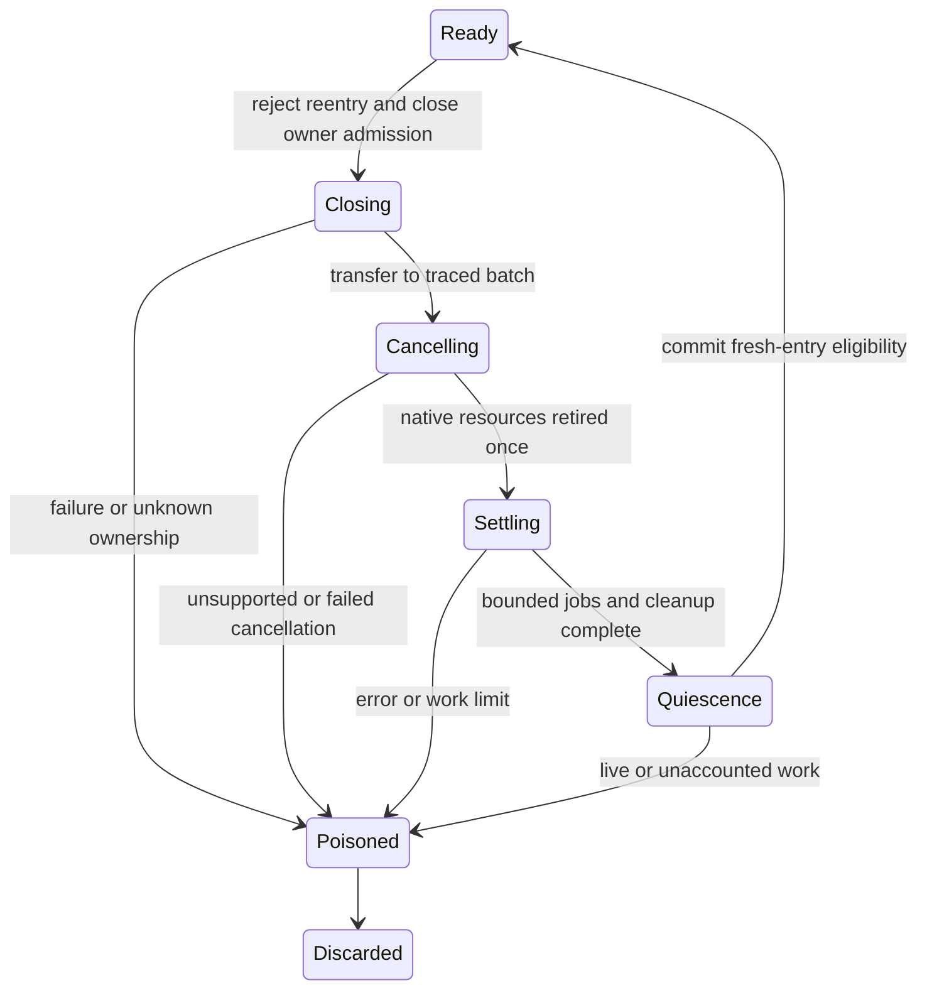

# Reset, cancellation and request ownership: source design v1

**Source audit and engineering proposal only. Reset/reuse remains unsupported.**
No reset, component, build, fault, DEBUG or OOM path was executed. No production
code, export manifest, prior evidence or engine was changed. This packet reserves
no profile version. It pins27 source/header inputs, inventories7 task types and
separates17 source findings from the proposed seven-phase protocol and eight-step
roadmap. Exact pins and symbols are in [source-audit.json](source-audit.json).

The private tick feature still defaults OFF and introduces no public process API.
When ON, its active-checkpoint reset guard rejects one unsafe entry condition;
it does not establish cancellation or reuse. The exact current ordinary embedding
source (`9dcb63be…`) contains no Engine reset call, and the diagnostic calls only
its reset precondition guard. These source defects therefore do not mean the
accepted v11 or current diagnostic tests invoked reset. Retained pure exports
with intentional module state also do not prove HTTP request isolation.

The immediate blockers are concrete:

- [`Engine::reset`](../../../../runtime/engine.cpp#L799) calls event-loop reset,
  timer reset and event-loop reset again. [`EventLoop::reset`](../../../../runtime/event_loop.cpp#L343)
  cancels the live task vector, ignores cancellation results, clears its owning
  RefPtrs and forces interest to zero. [`TimersMap`](../../../../builtins/web/timers.cpp#L18)
  retains raw pointers. `TimerTask::cancel` leaves those entries, so sole-queue
  timer ownership can end before `timers::reset` dereferences the pointers.
  This is a source ownership proof, not an executed fault.
- `EventLoop::cancel_async_task` erases before calling through a const RefPtr
  reference. Ordinary raw-to-temporary-RefPtr calls retain the C++ task, but an
  argument aliasing its vector element can be invalidated. Even a copied native
  RefPtr does not independently trace the task's JavaScript Heap edges.
- Cancellation has no common terminal contract. The two HTTP body transfer tasks
  explicitly disallow it; incoming-body and response-future tasks have TODO
  cancellation methods. Invalidating an integer handle does not close the
  subscription, settle its Promise/stream or release the resource owner.
- `AsyncTask::select` prunes invalid entries after the event loop's nonempty test.
  All-invalid input can fall into `poll_handles(empty)`, whose ready-result path
  assumes an element. Cancellation must handle empty-after-prune explicitly.
- Reset does not drain/discard internal Promise jobs, pending native completions
  or queued FinalizationRegistry callbacks. Clearing rejection tracking and
  strict latches can erase failure evidence; subsequent GC can enqueue new work.
  Rewinding timer IDs to1 can also alias stale IDs across a reuse boundary.

The [cancellation matrix](cancellation-matrix.json) covers TimerTask,
BodyFutureTask, ResponseFutureTask, BufReader StreamTask, BodyWriteAllTask,
BodyAppendTask and the separate diagnostic BoundaryTask. The latter's idempotent
active flag and interest release are a useful control pattern, not proof that
real timers, HTTP resources or streams are cancellable. `ResponseFutureTask::abort`
is distinct from its TODO generic cancel method. `HttpIncomingBody::subscribe`
returns a pollable without assigning the field its unsubscribe method checks;
its close method is also a TODO. Outgoing `close` uses a blocking flush and is
not an acceptable bounded abort implementation. The two raw body-owner pointers
in BodyAppendTask need an explicit lifetime proof through every transfer state.

A safe future design must retain ownership through cancellation. Add a cancelling
batch to the existing TaskQueue owner and trace it alongside queued/running tasks
and settlement records. Set a separate reset/closing guard **before** moving tasks
or invoking virtual methods. Swap the active queue into that traced batch without
allocation; do not move it to an untraced local vector. Keep timer registration
ownership until unregister and terminalization finish. Strong registry RefPtrs
or reviewed weak handles are possible; raw registry pointers with independent
queue destruction are not. A running task also needs an explicitly traced owner
through callbacks and any attempted cancellation.

Every task needs queued/running/cancelling/completed/cancelled terminal states
and operation-owned resource leases. Each actual interest source needs an
exactly-once token; a task that owns none must not decrement the global count. Normal finish,
abort and cancel must not each unsubscribe or decrement independently. Drop child
pollables before their parent streams/bodies, release owned byte payloads once,
and distinguish cancelled settlement from successful completion. Do not call a
normal success callback to make a transfer appear finished. Failure must retain
owned cleanup state and preserve the first error; it cannot produce a reusable
engine by clearing counters. If a task cannot cancel safely, discard the instance.

[`queue_async_task`](../../../../include/extension-api.h#L168) currently returns
void and appends to std::vector. The timer constructor subscribes and inserts into
a registry before that enqueue. A transactional registration path must therefore
precede a recoverable cancellation API: reserve fallible storage, establish owned
rollback, acquire resources, and commit queue/registry/interest together. A rejected
enqueue while closing must acquire nothing or roll everything back. Proposed
fallible guest-internal entry points are future API changes, not existing embedding
functions. A retained void wrapper must fail closed; it cannot silently discard
registration or claim recoverable OOM. No new allocator-failure proof is supplied.

[reset-protocol.json](reset-protocol.json) defines the proposed state transition:

These state names are proposals, not new current EngineState values. Reject reset
from a running task/export, tick/job checkpoint, poll, cancellation or another reset
before mutation. Closing must reject fresh work registration, including requeues.
Native resource retirement comes before explicitly defined cancellation settlements;
those settlements execute under the old closing owner and can queue cleanup jobs.
A bounded dispatcher must then reach quiescence without losing error evidence.
Only afterward may runtime-owned request roots be dropped and the next owner begin.
Never assign interest zero to hide a leak or clear an unhandled Set to pass a gate.
Any unknown resource, failure or exceeded budget makes the instance nonreusable.

Promise ownership is a separate dependency. The pinned147 headers expose
`js::HasJobsPending`, `RunJobs`, `StopDrainingJobQueue` and `RestartDrainingJobQueue`.
Stopping is not cancelling or discarding jobs; an empty queue does not prove that
pending native operations or unresolved Promises cannot enqueue later. Debugger
saved queues restore their captured jobs and are not reset machinery.
`JS::ShutdownAsyncTasks` is runtime shutdown support, not a reusable request-reset
primitive. The dispatch callback contract makes refusal of further runnables a
one-way shutdown transition. None of these APIs proves arbitrary reset safe.

A controlled job queue may support future owner-aware teardown and ALS, but the
[existing async-context audit](../../async-context/architecture.md) must govern it.
The default147 native microtask preference can bypass `enqueuePromiseJob`. Select
the supported legacy-queue preference and install `JS::SetJobQueue` before any
application Promise registration if that reviewed approach is chosen. Preserve full
job draining, kept-object cleanup and error tracking. Production adoption still
needs off-thread dispatch, realm, debugger-saved-queue and Promise-creation metadata
policies; the isolated [resource model](../../async-context/resource-model.md) is
not installed ALS. Deterministic task/job/cleanup budgets need versioned decisions;
existing tick and16-round finalizer limits do not bound all Promise work.

Request ownership and ALS context must remain distinct. Actual ComponentizeJS export
and native HTTP entry need a fresh owner/epoch and a fresh root context for unrelated
requests, not a previous request's mutable cell. The deployed-entropy bit is permanent
policy state, not an owner. `REQUEST_HANDLER_ONLY` tests Initialized state only.
FetchEvent singleton/pending-count/streaming-body state and the native HTTP outparam
are additional owners that queue clearing does not reset.

Capture a traced context cell and owner at actual task/timer/resource creation and
Promise registration/creation hooks, restore them at dispatch, and restore the
caller's context on every return/throw. Preserve an interval or deliberately reused
AsyncResource's mutable resource cell; capture an explicit empty context separately
from an optimized-out sentinel. `run` restores only its ALS instance. Owner expiration
must not be used to implement ALS.disable, which has different re-enable semantics.
Await/native reactions and thenable Promise-creation behavior require the pinned
capture design, not a Promise.then facade or current-request global.

Retire old request-owned host resources before admitting another request. Define
whether cleanup reactions run while Closing and how late completions are rejected.
Application-owned resources and intentional module state are a separate contract;
user references can retain stores, so successful runtime cleanup does not erase all
application memory. Full isolation may require a fresh component instance. An
untracked job/resource or incomplete cancellation keeps same-instance request reuse
unsupported, even when the tick FIFO is idle.

No new host service is needed. Resource-specific teardown must use only the selected
standard WASI0.2.10 interfaces already required by that variant. Pure guest cleanup
must not widen imports. Mixed native-pollable and immediate task selection currently
creates a cached subscribe-duration(0) pollable, with no shown reset/drop path. Its
lifetime must be explicitly engine-owned or scoped, and no live handle may enter a
snapshot. This branch can need a **callable** monotonic-clock import; today's type-only
HTTP clock proof does not cover it. No DNS/socket/TLS capability follows from HTTP.

The dependency-ordered [roadmap and validation gates](roadmap.json) first repair
registration ownership and timer retirement, then HTTP/stream cancellation, bounded
jobs/finalizers, request ownership and correct ALS. Only new hardened code may run
ordinary Release/Release-GC lifecycle tests. Those future tests cover traced detached
batches, reentrant/refused registration, exactly-once resource and interest release,
stale IDs, handled/unhandled settlement and late old-owner completions. Generic
fatal ABI tests remain boundary/discard observations paired with successful controls.
No old unsafe reset, detach/shared/fault or private DEBUG probe is authorized here.

Finally, prove controlled retained-instance behavior and then the production host
lifecycle separately. Use real selected standard interfaces on unmodified Wasmtime
and wasmCloud. Guest-owned lease counters are useful but are not universal host
resource-table introspection. If a host does not provide an actual same-instance
request witness, keep HTTP reuse unproved; counters `[1,1,1]` do not supply one.
Measure final size/startup/memory and retained stores only after correctness. This
packet adds no runtime, performance or complete Node compatibility claim.
